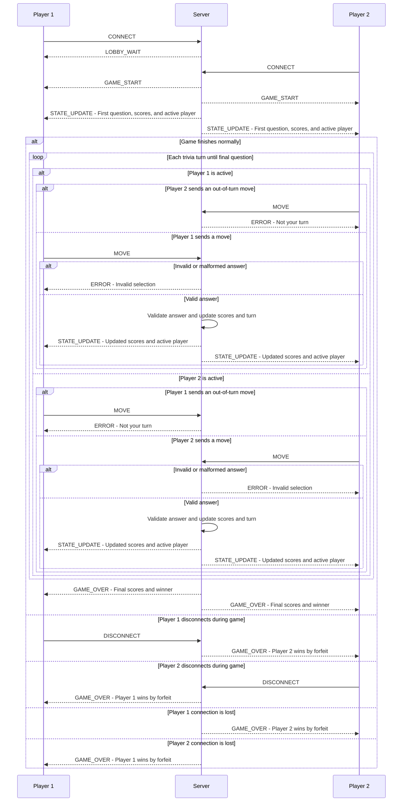

# Server Concurrency Architecture Design

## 1. Server Concurrency Model

For terminal trivia, it was chosen that non-blocking I/O using Pythons selectors module. This will allow the server to handle multiple client connections in a single thread wihtout needing seperate threads for each player.

Server uses an event loop to check which client sockets are ready to send or receive data. This prevents the server from getting stuck waiting for one plater while another plater is trying to communicate.

## 2. Connection Lifecycle

1. **Server Startup:** Ther server creates a TCP listening socket, binds it to an address and port, starts listening, and registers the socket with the selector.

2. **Client Connection:** When a client connects, the server accepts the connections, sets the client socket to a non blocking mode using  `setblocking(False)`, and registers it with the selector for reading

3. **Player Registration** The server receives a `CONNECT` message and assigns the client a player role. THe first player receives a `LOBBY_WAIT`, and when a second player joins both players will receive a `GAME_START`.

4. **Active Game:** The event loop handles incoming `MOVE` messages, then it checks whose turn it is, validates the answers, updates the game state, and then sends `STATE_UPDATE` messages to both players.

5. **Client Disconnection:** If a player sends `DISCONNECT`, it then closes the connection, or loses connection unnecpectedly, the server unregisters and closes their socket. During an active game the remaining player will win by forfeit.

6. **Game Reset:** After  `GAME_OVER`, the server clears the current game information and returns to `WAITING_FOR_PLAYERS` so another game can begin.

## 3. Handling Multiple Clients

The server uses `selectors.DefaultSelector()` to be able to monitor multiple client sockets at the same time. Instead of waiting for one client to finish before checking another, the event loop processses sockets whenever they are ready.

Each client has its own receive buffer to handle incomplete TCP messages and a send buffer for outgoing messages. Messages use the 4byte big endian length prefix define in Sprint 1.

The server then monitors soclets for reading and enables write monitoring when a client has outgoing data. If a message cannot be sent completely the remaining byes stay in that clients send buffer until the socket is ready again.

Terminal Trivia supports two active players per game. The server can accept additional connections without blocking, but only two clients can have active player roles at a time. Any additional clients are kept separate from the current game and cannot submit moves or change the game state.

## 4. Thread Safety and State Isolation

Terminal trivia uses a single threaded event loop with Pythons  `selectors`, Since the server processes one event handler at a time, we dont need `threading.Lock` to protect the shared game data.

The server leepst track of the following information:

- **Connected Clients:** Stores the connected client sockets and their assigned player roles.
- **Current Turn:** Tracks whether P1 or P2 is allowed to answer.
- **Game State:** Stores the cuurrent trivia question, asnwer choices, and game progress.
- **Player Scores:** Keeps track of each players score during the game.
- **Game Status:** Tracks whether the game is waiting for players, active or finished.

## 5. Preventing Race Conditions

The server handles events one at a time, so two players cant update the shared game information at the exact same time.

When a player sends a `MOVE`, the server first checks if its their turn and whether the move is valid. If the move is invalid or out of turn, the server sends an `ERROR` and keeps the current turn.

If both players send moves at nearly the same time, the event loop processes them one at a time. Thes erver finishes checking the move, updating the score, and changing turns before processing another move.

The server does not pause for socket reads or writes while updating the game state. Outgoing messages are placed in each clients send buffer so they can be sent when the socket is ready.

## 6. Client State Isolation

Each client has its own socket, plater ID, receive buffer and send buffer. This keeps messages from different players seperate.

Only the servers even loop can update the shared game information. Clients cant directly change scores, turns, or game progress.

After a valid move the server queues a `STATE_UPDATE` message for both players containing the update scores, game state, and current turn. This helps keep both players synchronized!

## 7. Mermaid Sequence Diagram

This diagram shows how both players connect to the server, take turns asnwerung trivia questions and receive game updates. The server uses the selectors event loop to process messages one at a time.

## 8. Move Validation and State Broadcast

When a player sends a `MOVE`, the server checks if it is their turn and whether the answer is valid. If the move is out of turn or invalid, the server sends an  `ERROR` to that player without changing the current turn or scores. The player can try again when its their turn.

For a valid move the server evaluates the asnwer, updates the players score and cahnges the active turn. The updated game information is then placed into both players' send buffers as a `STATE_UPDATE` message.

Both players receive the same updated scores, current turn, and game progress. Since the server uses a simgle threaded event loop, these updatesare processed in order without two players changing the game state at the same time.

If a player disconnects during the game the server detects the `DISCONNECT` message a 0 byte EOF or a socket error, THe remaining player wins by forgeit and receives a `GAME_OVER`. After the game ends the server clears the game data and returns to `WAITING_FOR_PLAYERS`.

The server stores both players' scores in a shared score dictionary using each player ID as the key. After a valid answer is evaluated, the server updates the score dictionary and then includes the updated scores in the STATE_UPDATE message sent to both players. Both players receive the same score table, which keeps the leaderboard synchronized after each completed turn.
